 | [](LICENSE) | [](https://github.com/sponsors/felipetjmg1-bit)

<p align="center"></p>


# Painel Estático da Impulso Digital

## Visão geral

O README descreve um componente de um ecossistema de soberania tecnológica, mas os arquivos verificáveis mostram principalmente um site/painel estático da Impulso Digital: apresenta cartões para Oráculo X-37, Sentinela das Águas e Tokens Aurora, números/logs escritos no HTML e links para repositórios externos. O código não comprova que os indicadores representem monitoramento ou serviços operacionais.

## Objetivo e valor

**Problema/escopo:** Painel estático da Impulso Digital em HTML, CSS e JavaScript, com cartões de projetos e links para repositórios relacionados.

**Valor verificável hoje:** o repositório torna explícitos seus artefatos, interfaces e limitações para que mantenedores e contribuidores possam avaliar o que existe sem confundir demonstração, proposta e produção.

## Arquitetura e tecnologias

A arquitetura não está documentada. A árvore indica um site estático pequeno, com página principal index.html e cópia index_backup.html; estilos e scripts estão embutidos no HTML, sem diretórios de aplicação, pacotes ou módulos visíveis. A árvore da branch main contém .github/ISSUE_TEMPLATE, mas não .github/workflows.

- HTML (linguagem indicada pelo GitHub e arquivos index.html/index_backup.html).
- CSS embutido no index.html; layout responsivo e estilos inline no mesmo arquivo.
- JavaScript embutido no index.html para atualizar um relógio local e acrescentar mensagens de log simuladas.
- Google Fonts externos: Orbitron e JetBrains Mono; não há manifesto de dependências/build na árvore pública examinada.

## Início rápido

Este repositório não fornece atualmente uma sequência verificável de instalação e execução de software. Para consultar os materiais disponíveis:

```bash
git clone https://github.com/felipetjmg1-bit/felipetjmj1.github.io.git
cd felipetjmj1.github.io
```

Não há comando de runtime documentado nos arquivos auditados.


## Exemplo de uso

Exemplo limitado ao que o HTML realmente oferece: abrir a página principal e selecionar o link “Acessar Inteligência”, que aponta para https://github.com/felipetjmg1-bit/ORACULOX37-V-3.6.9. Isso apenas navega para um repositório externo; não demonstra instalação, API ou operação do Oráculo. Não há comando de instalação/execução documentado. A URL de GitHub Pages tentada não pôde ser verificada nesta consulta.

## Estado e limitações

**Estado de entrega:** painel estático de apresentação.

- Os valores de confiança, latência, área, alertas, supply e holders aparecem como conteúdo fixo no HTML; os logs adicionais são gerados por listas de mensagens aleatórias no próprio JavaScript. Não os apresente como dados medidos ou monitoramento real sem evidência independente.
- A única atualização dinâmica observada é o relógio local e a animação dos logs; não há integração de dados/API demonstrada no HTML inspecionado.
- Não inventar comandos de instalação, execução ou testes: nenhum foi encontrado nos arquivos/manifestações consultados.
- A URL de Pages não foi confirmada; a tentativa de extração falhou. A API indica has_pages=true, o que não confirma por si só que o site esteja acessível.

## Contribuição

Leia [CONTRIBUTING.md](CONTRIBUTING.md) antes de abrir uma issue ou pull request. Para reportes de segurança, siga a orientação específica do repositório, se houver.

## Licença

Este repositório está licenciado sob **MIT**; consulte [LICENSE](LICENSE).

## Patrocínio e apoio

O desenvolvimento aberto exige tempo para manutenção, documentação, testes, revisão de contribuições e resposta a issues. Se este projeto for útil, considere apoiar a continuidade pelo [GitHub Sponsors](https://github.com/sponsors/felipetjmg1-bit). O apoio não representa promessa de funcionalidades, prazo de entrega ou suporte comercial.

[](https://github.com/sponsors/felipetjmg1-bit)


**Empresa responsável:** Impulso Digital Soluções em IA.
